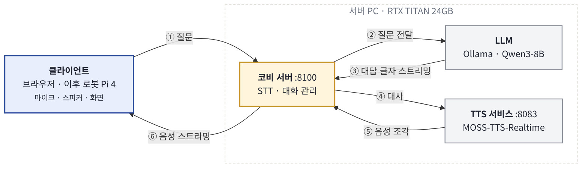

# kobi

한국기술교육대학교 마스코트 '코리'를 입힌 인터랙션 로봇 **코비**의 대화 서버입니다.
지금은 1-1 시나리오(캠퍼스·행사 안내)를 구현하는 단계로,
브라우저에서 질문하면 코리 말투의 음성으로 답합니다.



| 구성 | 역할 | 기술 | 환경 | 포트 |
|---|---|---|---|---|
| 코비 서버 | 질문을 받아 대답을 정하고, TTS 음성을 클라이언트로 전달 | FastAPI + WebSocket | `kobi` | 8100 |
| LLM | 대답 생성 | Qwen3-8B (Ollama) | Ollama 서비스 | 11434 |
| TTS 서비스 | 대사를 음성으로 | MOSS-TTS-Realtime | `kobi-tts` | 8083 (내부 전용) |
| 웹 데모 | 브라우저에서 질문·음성 재생 | HTML + Web Audio | — | 코비 서버가 제공 |

---

## 1. 폴더 구성

```
kobi/
├── start.sh                    # TTS 서비스 + 코비 서버 한 번에 실행
├── server/
│   ├── app.py                  # 코비 서버
│   └── config.yaml             # 포트, 모델, 목소리 견본, 임시 페르소나
├── web/index.html              # 웹 데모 페이지
├── checks/                     # 설치 확인 스크립트
│   ├── check_stt.py
│   └── check_embed.py
├── tts/
│   ├── moss_fp16.patch         # MOSS-TTS 수정분 (RTX TITAN fp16 대응)
│   ├── MOSS_COMMIT             # 패치를 적용한 MOSS-TTS 커밋
│   └── MOSS-TTS/               # (git에 없음) 직접 clone
├── requirements-kobi.txt
└── requirements-kobi-tts.txt
```

## 2. 설치

### 2-1. 준비물
- NVIDIA GPU (개발 환경: RTX TITAN 24GB)
- 드라이버가 CUDA 12.8 이상 지원 (`nvidia-smi`의 `CUDA Version`으로 확인)
- conda, Ollama

### 2-2. Ollama 모델

```bash
ollama pull qwen3:8b
ollama pull bge-m3          # 행사 자료 검색용 (1단계에서 사용 예정)
```

컨텍스트 길이를 줄여서 GPU 메모리를 아낍니다 (32768 → 8192, 약 10GB → 6.3GB).

```bash
sudo mkdir -p /etc/systemd/system/ollama.service.d
printf '[Service]\nEnvironment="OLLAMA_CONTEXT_LENGTH=8192"\n' \
  | sudo tee /etc/systemd/system/ollama.service.d/override.conf
sudo systemctl daemon-reload && sudo systemctl restart ollama
```

모델을 GPU에 계속 올려 두는 설정(`keep_alive`)은 코비 서버가 요청마다 직접 관리하고, 서버를 끄면 모델을 내립니다.

### 2-3. MOSS-TTS 받기 + 패치 적용

```bash
git clone https://github.com/OpenMOSS/MOSS-TTS.git tts/MOSS-TTS
git -C tts/MOSS-TTS checkout $(cat tts/MOSS_COMMIT)
git -C tts/MOSS-TTS apply ../moss_fp16.patch
```

패치 내용: RTX TITAN(Turing)은 bf16을 지원하지 않는데 PyTorch가 지원한다고 응답해서,
`fast_api.py`와 예제 스크립트가 fp16을 쓰도록 하고 모델 전체를 fp16으로 변환합니다.

### 2-4. conda 환경

```bash
# 코비 서버 (Python 3.11)
conda create -n kobi python=3.11 -y
conda activate kobi
pip install -r requirements-kobi.txt

# TTS 서비스 (Python 3.12)
conda create -n kobi-tts python=3.12 -y
conda activate kobi-tts
pip install -r requirements-kobi-tts.txt
conda install -c conda-forge "ffmpeg<8" -y
pip install --force-reinstall --no-deps "torchcodec==0.8.1" --index-url https://pypi.org/simple
```

마지막 두 줄은 TTS가 목소리 견본 파일을 읽는 데 필요합니다(아래 문제 해결 참고).

### 2-5. 설치 확인 (선택)

```bash
conda activate kobi
python checks/check_stt.py test.wav     # 5초 한국어 녹음 (16kHz 모노)
python checks/check_embed.py
```

## 3. 실행

```bash
chmod +x start.sh       # 처음 한 번
./start.sh
```

- TTS 서비스가 뒤에서 뜨고(로그: `logs/tts.log`), 코비 서버가 TTS를 기다렸다가 워밍업 후 시작합니다. 처음에는 30초 정도 걸립니다.
- 화면에 나오는 주소로 접속합니다.
- **Ctrl+C** 한 번이면 TTS 세션을 닫고 Ollama 모델을 GPU에서 내린 뒤 모두 종료됩니다.

## 4. 접속

| 상황 | 주소 |
|---|---|
| 서버 PC | `http://127.0.0.1:8100/` |
| 같은 네트워크의 다른 기기 | `http://<서버IP>:8100/` (`https`가 아니라 `http`로 입력) |
| 다른 네트워크 | 노트북에서 `ssh -L 8100:127.0.0.1:8100 <사용자>@<서버>` 후 `http://localhost:8100/` |

방화벽을 쓰면 `sudo ufw allow 8100/tcp`로 포트를 엽니다.
브라우저 마이크(다음 단계)는 `https`나 `localhost`에서만 동작하므로, 다른 기기에서 시연할 때는 SSH 터널 방식을 권장합니다.

## 5. 설정 (`server/config.yaml`)

| 항목 | 설명 |
|---|---|
| `server.port` | 코비 서버 포트 (8000번은 VS Code 포트 포워딩과 겹쳐서 8100 사용) |
| `ollama.model`, `num_ctx` | LLM 모델과 컨텍스트 길이 |
| `tts.prompt_audio` | 목소리 견본. kobi 폴더 기준 상대경로. 한국어 화자 견본(10~20초, 대화체)을 쓰면 발음이 좋아짐. 실제 사람 목소리는 본인 동의 필수 |
| `dialog.persona` | 임시 코리 말투 설정 (1단계에서 캐릭터 설정 파일로 대체 예정) |

## 6. 진행 상황

- [x] 0단계: STT·LLM·임베딩·TTS 설치 및 동작 확인
- [x] 2단계 일부: 텍스트 질문 → 음성 답변 스트리밍, 웹 데모, 원격 접속, 실행 스크립트
- [ ] 실제 응답 시간 측정 (목표: 질문이 끝난 뒤 첫 소리까지 2초 이내)
- [ ] 2-3: 브라우저 마이크 + VAD → STT (음성으로 질문)
- [ ] 1단계: 코리 캐릭터 설정, 행사 자료 검색(RAG), 동작·표정 태그
- [ ] 3~4단계: 표정 화면, 동작 로그, QR 화면, 시나리오 흐름